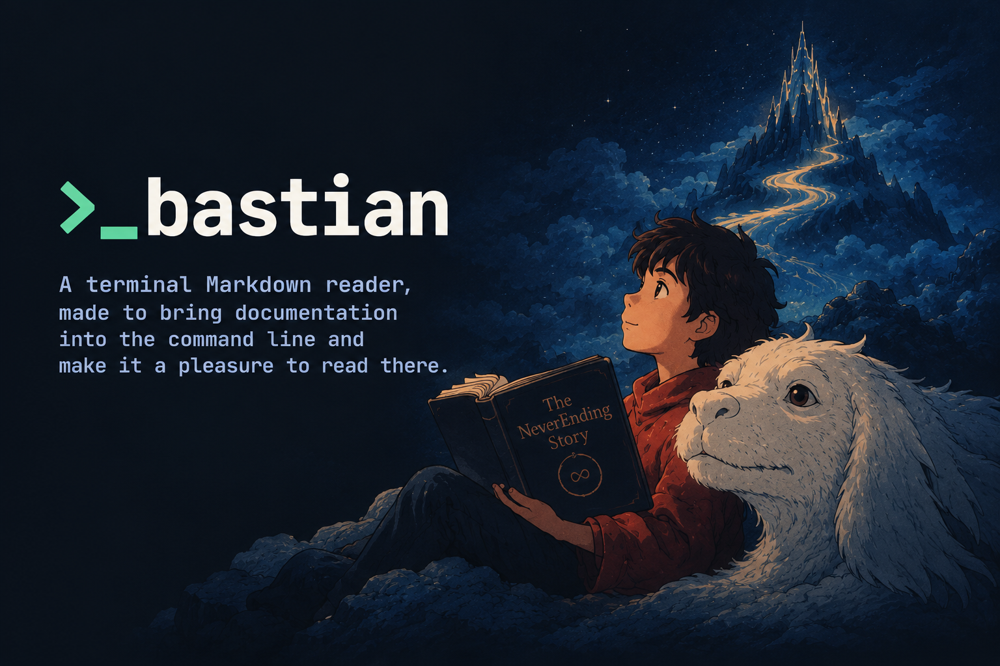
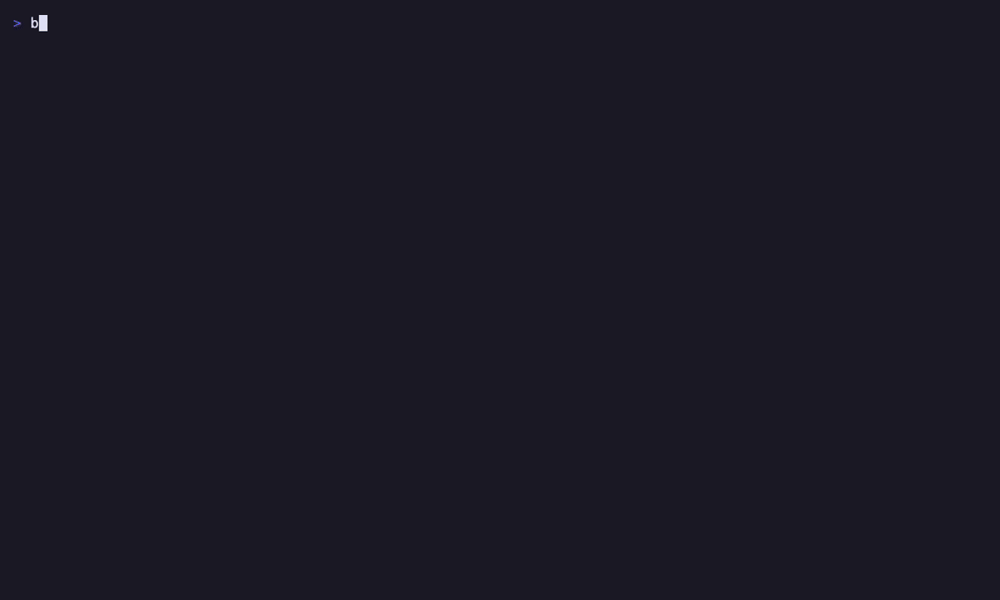

# bastian



A terminal Markdown reader, made to bring documentation into the command line
and make it a pleasure to read there.

Use it to discover Markdown files and read them without leaving the terminal.
bastian finds the Markdown in a directory and its subdirectories, or across a
Git repository, and lists it newest first, ready to filter. Open a document to
read it laid out for the terminal: headings, lists and tables fitted to the
width, highlighted code, links you can follow or click, images where the
terminal can draw them, an outline to jump through, search, and a live reload
whenever the file changes.

It reads local files, standard input, URLs and GitHub or GitLab READMEs, MDX
as well as plain Markdown, and comes with popular color themes or your own.
For runbooks and setup guides it can also run a document's shell, Python or
Node code blocks right where you read them.

Named after Bastian Balthazar Bux, who reads *The NeverEnding Story* until he
ends up inside it.

## Install

bastian is built with Cargo; get it with [rustup](https://rustup.rs) if you
don't have it. Then install it from crates.io:

```sh {name=install}
cargo install --locked bastian
```

For the latest unreleased changes, install from GitHub instead:

```sh {norun}
cargo install --locked --git https://github.com/mainframev/bastian
```

Either puts `bastian` in `~/.cargo/bin`, which rustup adds to your `PATH`.
Run the same command again to update.

## Usage

```sh {norun}
bastian                 # browse Markdown files under the current directory
bastian docs/           # browse another directory
bastian -a              # also list hidden and gitignored files
bastian README.md       # read a file
cat notes.md | bastian -
bastian github.com/owner/repo         # a repository's README (GitLab too)
bastian https://example.com/doc.md    # any Markdown URL
bastian https://github.com/o/r/blob/main/docs/guide.md  # file pages are read raw
bastian -p README.md    # print instead of opening the TUI
bastian --pager README.md  # page it through $PAGER (default less -R)
bastian --color always README.md | less -R
bastian -y runbook.md   # run blocks without confirming each one
bastian -n README.md    # show line numbers
bastian -t kanagawa README.md  # use another theme
```

## Keys

| Key | Reader |
|-----|--------|
| `j/k`, `ctrl-d/u`, `space/b`, `g/G` | scroll |
| `/`, `n/N` | search, next/previous match |
| `Tab`, `Shift-Tab` | focus next/previous code block |
| `Enter`, `r` | run focused block |
| `R` | run all runnable blocks from the focused one, stop at first failure |
| `x` | stop running blocks |
| `o` | show/hide a block's output |
| `y` | copy focused block (OSC 52) |
| `c` | copy the whole document |
| `L` | list links; follow one with `Enter` |
| `O` | outline of the headings; `Enter` jumps to one |
| `e` | edit the file in your `editor`, `$VISUAL`, `$EDITOR` or `vi`, at the line you're reading |
| `ctrl-z` | suspend; resume with `fg` |
| `#` | toggle line numbers |
| `i` | show/hide images |
| `T` | pick a theme (also in the browser) |
| `?` | key help |
| `Esc`, `h` | back to the previous document or the browser |
| `q` | quit |


In the browser: `j/k` to move, `h/l` (or `←/→`) for the previous/next page,
`ctrl-d/u` and `ctrl-f/b` to page, `/` to filter,
`Enter` to open, `e` to edit, `r` to rescan for new or deleted files, `?` for
all keys, `q` to quit.

The search and filter input edits like a shell prompt: `←/→`, `Home/End`
(or `ctrl-a/e`), `alt-b/f` by word, `ctrl-w` and `ctrl-u` to delete. While
filtering, `↑/↓`, `PageUp/PageDown` and `ctrl-j/k` leave the input and move
through the results.

Links are also clickable in terminals that support hyperlinks (OSC 8: iTerm2,
kitty, WezTerm, Ghostty, Windows Terminal, recent tmux with `hyperlinks` in
`terminal-features`, …): web links open as they are, relative links as files
next to the document (or against the URL of a remote document).

An image on a line of its own is shown as a picture in the reader (kitty
graphics in kitty and Ghostty, iTerm2's in iTerm2 and WezTerm, colored
half-blocks elsewhere and inside tmux), from a file next to the document or a URL. Images in
running text, SVGs (such as most badges) and printed output keep their alt
text.

The open document reloads when the file changes on disk.

Remote documents (URLs, `github.com/owner/repo`, `gitlab.com/group/project`)
resolve relative links against their URL, so `L` can follow them to other
remote Markdown files. Their code blocks run in the current directory and
always ask first, even with `--yes`. Set `GITHUB_TOKEN` to avoid GitHub's
anonymous rate limit.

`.mdx` files are parsed as MDX: front matter, `import`/`export` and
`{/* comments */}` are hidden, components show as muted tag lines around their
rendered content, and code blocks inside components can still be run. Front
matter is hidden in plain `.md` files too.

## Running code blocks

Fenced code blocks in `sh`, `bash`, `zsh`, `fish`, `python` or `node` can be
run from the reader, with their output streamed underneath. Try it on this
file: open it with `bastian README.md`, press `Tab` to focus the block below
and `Enter` to run it.

```sh {name=hello}
echo "hello from $(basename "$PWD")"
uname -sm
```

Put attributes in braces after the language:

````markdown
```sh {name=deploy cwd=./infra env=STAGE=prod timeout=5m confirm}
./deploy.sh
```
````

| Attribute | Effect |
|-----------|--------|
| `name=...` | label shown on the block and in prompts; quote values with spaces |
| `cwd=...` | working directory, relative to the document's directory |
| `env=KEY=VALUE` | environment variable; repeat for more |
| `timeout=30s` | stop the block after `ms`, `s`, `m` or `h` |
| `confirm` | always ask before running, even with `--yes` |
| `norun` | never run this block |

Blocks run in the document's directory with no terminal attached, so
interactive programs (editors, ssh, password prompts) don't work. Each block
runs in its own process group; stopping it or quitting bastian stops everything
it started.

## Configuration

`~/.config/bastian/config.toml` (or `$XDG_CONFIG_HOME/bastian/config.toml`).
Command-line flags take precedence.

```toml
theme = "auto"        # match the terminal background, "dark", "light" or a theme name
dark_theme = "rose-pine"        # used by "auto" on dark backgrounds, and "dark"
light_theme = "rose-pine-dawn"  # used by "auto" on light backgrounds, and "light"
width = 100           # maximum document width
confirm = "always"    # "never" behaves like --yes
color = "auto"        # printed output: "auto", "always" or "never"
pager = false         # true: show documents in $PAGER instead of the TUI
all = false           # true: also list hidden and gitignored files
mouse = false         # true: scroll with the mouse wheel
logo = true           # false: no logo at the top of the file browser (--no-logo)
images = true         # false: show images as their alt text (--no-images);
                      # `i` toggles them in the reader
selector = "bar"      # how the browser marks the selected file: "bar",
                      # "thick", "block", "arrow" or "highlight" (--selector)
browser_layout = "cards"  # "compact" lists one file per row (--browser-layout)
sort = "modified"     # browser order: "modified", "created" or "name" (--sort)
dates = true          # false: no file dates in the browser
date_format = "%d %b %Y %H:%M %Z"  # strftime format of those dates
extensions = ["md", "markdown", "mdx", "mdown", "mkdn", "mkd"]  # files listed
ignore = []           # gitignore-style globs to leave out, e.g. ["drafts/"]
image_height = 24     # rows a picture takes up at most
tab_width = 4         # columns per tab in code
hyperlinks = true     # false: plain links, for terminals that show OSC 8 codes
scrollbar = true      # false: no scrollbars
# editor = "nvim"     # for `e`, before $VISUAL and $EDITOR
line_numbers = false  # true behaves like --line-numbers

[interpreters]
# The block source is appended as the last argument.
ruby = ["ruby", "-e"]
python = ["uv", "run", "python", "-c"]
fish = []             # an empty list stops a language from running
```

Printed output is colored when it goes to a terminal; `NO_COLOR` turns that
off and `CLICOLOR_FORCE=1` turns it on for pipes. Without `-w` it uses the
terminal width (up to 120 columns), or 80 when there's no terminal.

Use another file with `--config <path>` or `BASTIAN_CONFIG` (`~` and `$VAR` are
expanded). `bastian config` opens the file in your editor, creating it from a
commented template first, and `bastian --print-config` shows the effective
settings and where each one came from. To read a file literally named
`config`, write `./config`.

Each setting can also come from the environment: `BASTIAN_THEME`,
`BASTIAN_DARK_THEME`, `BASTIAN_LIGHT_THEME`, `BASTIAN_WIDTH`, `BASTIAN_CONFIRM`, `BASTIAN_LINE_NUMBERS`, `BASTIAN_COLOR`,
`BASTIAN_PAGER`, `BASTIAN_ALL`, `BASTIAN_MOUSE`, `BASTIAN_LOGO` and
`BASTIAN_IMAGES`. Precedence is
defaults < config file < environment < command-line flags.

## Themes

Built-in themes, which also color code blocks:

| Family | Themes |
|---|---|
| Tokyo Night | `tokyonight-night` (`tokyonight`), `tokyonight-storm`, `tokyonight-moon`, `tokyonight-day` |
| Rosé Pine | `rose-pine`, `rose-pine-moon`, `rose-pine-dawn` |
| Kanagawa | `kanagawa-wave` (`kanagawa`), `kanagawa-dragon`, `kanagawa-lotus` |
| Catppuccin | `catppuccin-mocha` (`catppuccin`), `catppuccin-macchiato`, `catppuccin-frappe`, `catppuccin-latte` |
| Gruvbox | `gruvbox-dark` (`gruvbox`), `gruvbox-light` |
| Nord | `nord` |
| Dracula | `dracula` |
| Everforest | `everforest-dark` (`everforest`), `everforest-light` |
| Solarized | `solarized-dark` (`solarized`), `solarized-light` |

```sh {norun}
bastian themes               # pick one with a live preview; Enter saves it
bastian -t nord README.md    # use a theme just this once
```



Or set it in the config file. The default, `auto`, follows the terminal's
background:

```toml
theme = "auto"                  # or "dark", "light", or a theme name
dark_theme = "rose-pine"
light_theme = "rose-pine-dawn"
```

Press `T` while reading or browsing to open the same picker.

### Your own themes

Put `<name>.toml` in `~/.config/bastian/themes/` (the `themes` directory next
to the config file) and select it by name. A theme can start from another and
change only some colors:

```toml
# ~/.config/bastian/themes/midnight.toml
extends = "tokyonight-night"

[ui]
accent = "#ff9e64"
h1_bg = "#ff9e64"

[syntax]
comment = "#7a88cf"
```

Without `extends`, a theme sets `appearance` (`"dark"` or `"light"`) and every
color. `[ui]` colors the document: `text`, `muted`, `subtle`, `surface`,
`accent`, `h1_fg`, `h1_bg`, `heading`, `link`, `code`, `match_bg`,
`current_bg`, `err`, `ok`, `warn`. `[syntax]` colors code blocks: `comment`,
`keyword`, `string`, `number`, `constant`, `function`, `type`, `operator`,
`punctuation`, `tag`, `attribute`, `inserted`, `deleted`. The built-in themes
in the repository's `themes/` directory are complete examples. A file named
after a built-in replaces it; to tweak a built-in in place, extend it under its
own name (`extends = "nord"` in `themes/nord.toml`).

## Shell completions and man page

```sh {norun}
bastian completions zsh > ~/.zfunc/_bastian   # also bash, fish, elvish, powershell
bastian man > bastian.1 && man ./bastian.1
```

## Development

```sh {name=check}
cargo fmt --check && cargo clippy --all-targets -- -D warnings && cargo test
```

With [just](https://github.com/casey/just) (`brew install just`), the same is
`just check`; `just lint` and `just test` run each half. Clippy runs with the
pedantic group plus a few extras, configured in the `[lints]` table of
`Cargo.toml`, and warnings fail the check.

`just install-hooks` makes git run the formatting and lint checks before each
commit in your clone (`git config core.hooksPath .githooks`). CI runs the full
check on macOS and Linux for every push and pull request.

The GIFs in this README are recorded from the scripts in `demo/` with
[vhs](https://github.com/charmbracelet/vhs) (`brew install vhs`); `just demo`
re-records them with your build.
