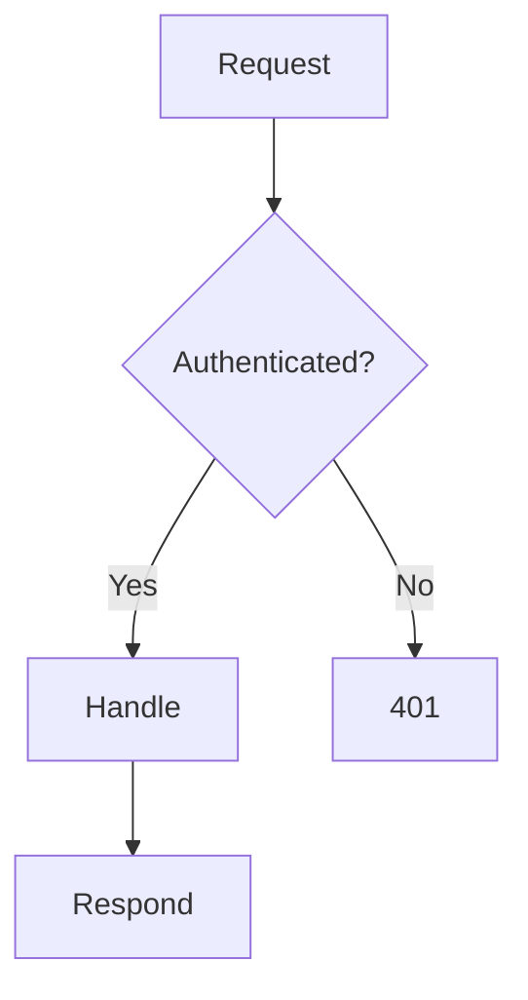
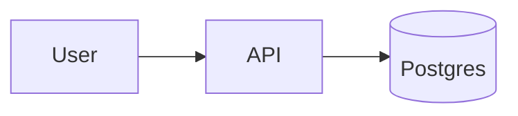
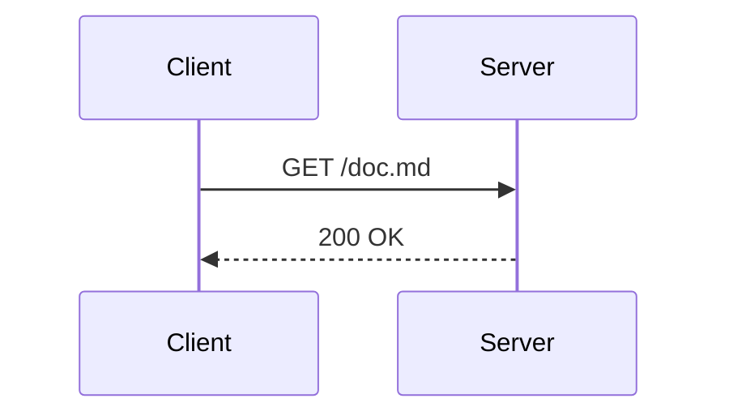
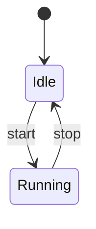
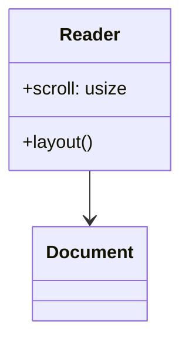
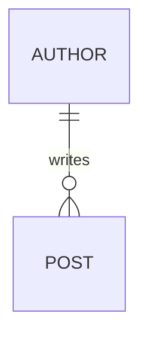
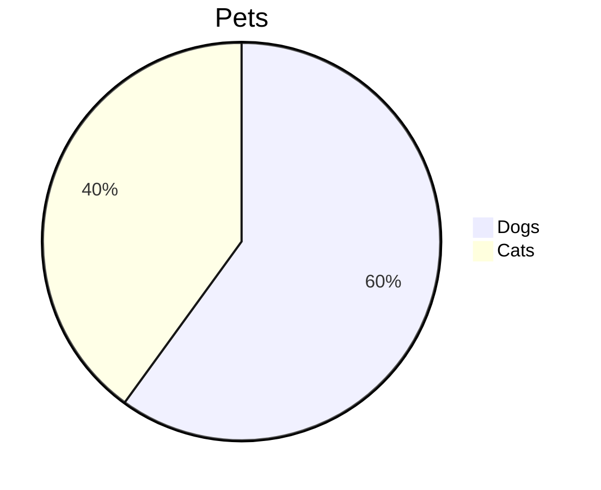

# Mermaid diagrams

## Flowchart



## Left to right



## Sequence



## State



## Class



## Entity relationship



## Not drawn as text



## Invalid

```mermaid
flowchart TD
  A -->
```
